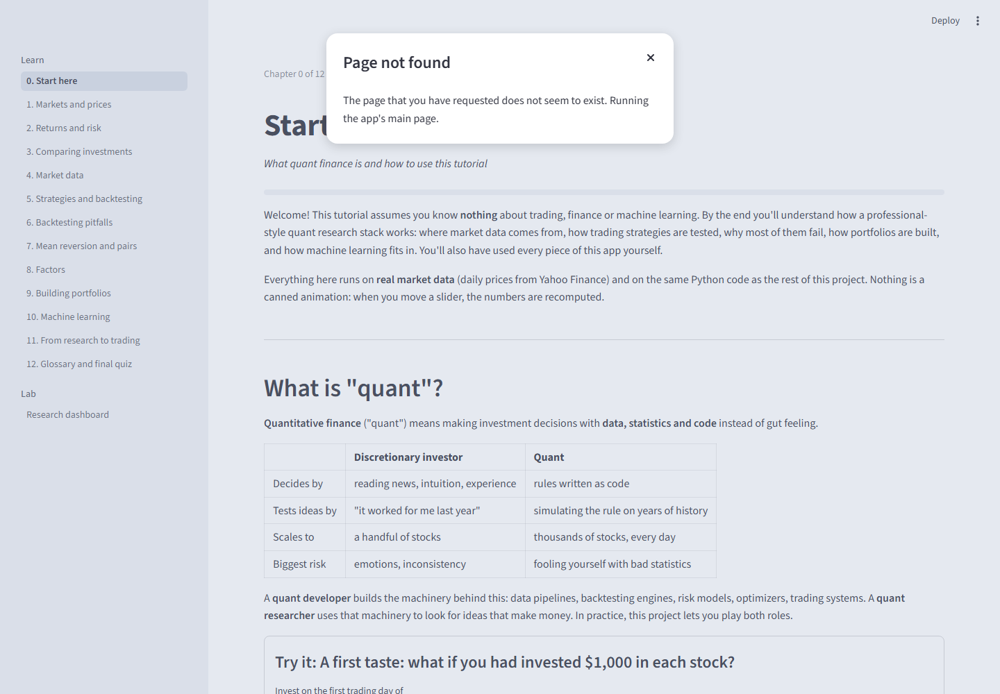
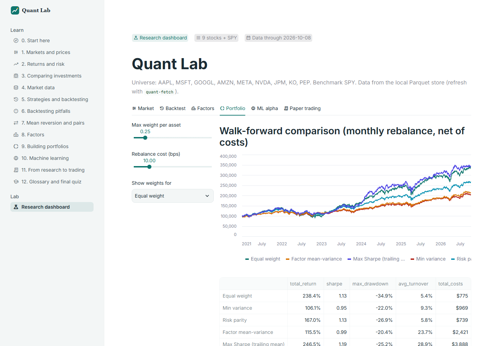
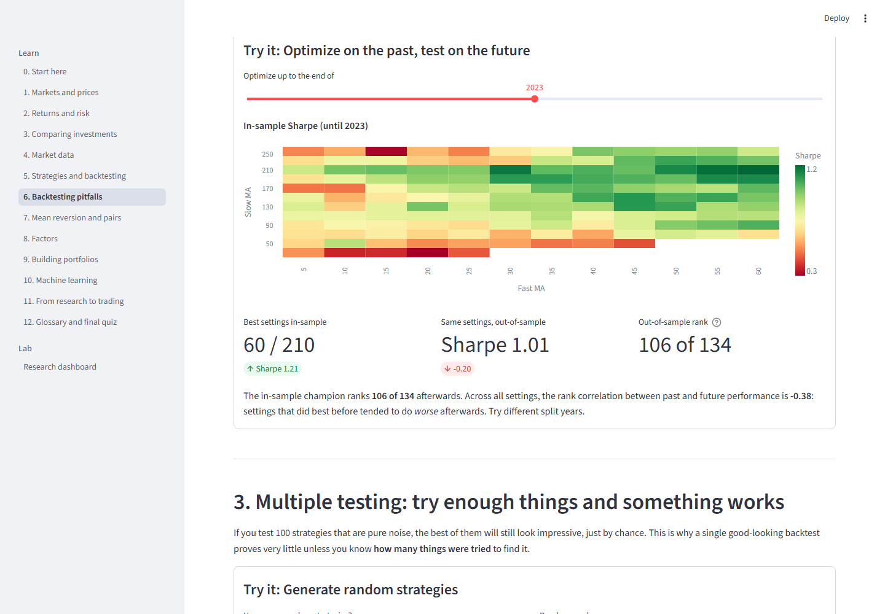
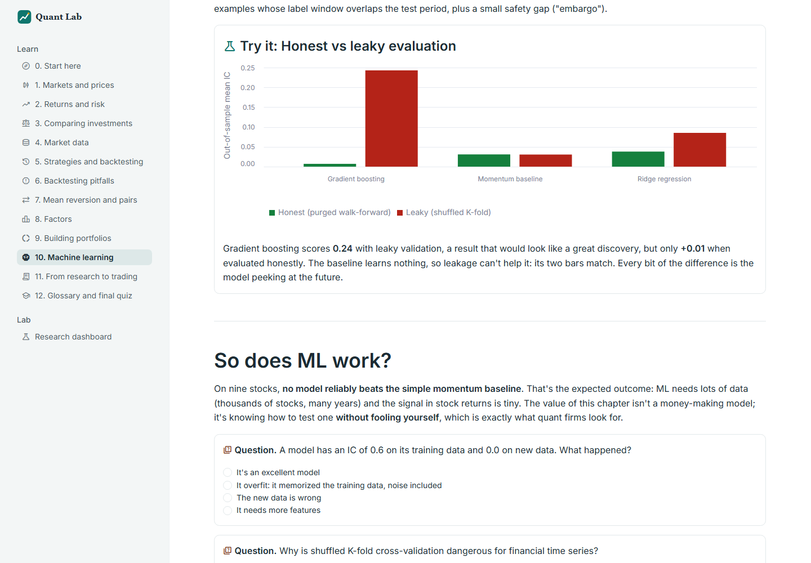
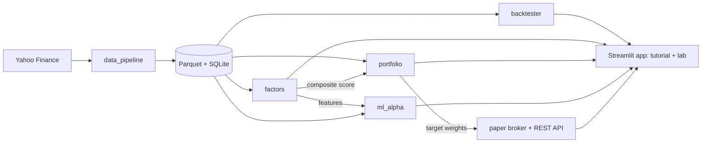

# Quant

[](https://github.com/JasonRaza/Quant/actions/workflows/ci.yml)


I'm a software engineering student, and this is the project I'm using to learn
quantitative finance. Instead of only reading about backtests and factor models, I
built a small research stack from scratch: a market data pipeline, a backtesting engine,
factor research, portfolio optimization, machine learning with proper validation, and a
paper-trading app with a REST API.

None of it makes money, and that's not the point. The most interesting results were the
ones where something that looked good fell apart under an honest test. To make sure I
actually understood the material, I also wrote an
**[interactive tutorial](#the-web-app)** inside the app that explains everything from
zero, with live experiments on real data.

<table>
  <tr>
    <td></td>
    <td></td>
  </tr>
  <tr>
    <td align="center"><sub>Tutorial home: 13 chapters and a live market snapshot</sub></td>
    <td align="center"><sub>Lab: walk-forward comparison of five allocators, net of costs</sub></td>
  </tr>
  <tr>
    <td></td>
    <td></td>
  </tr>
  <tr>
    <td align="center"><sub>Overfitting demo: the best past settings rank 106/134 afterwards</sub></td>
    <td align="center"><sub>Leakage demo: shuffled K-fold inflates IC from 0.01 to 0.24</sub></td>
  </tr>
</table>

## What's inside

| Part | Module | What it does |
|------|--------|--------------|
| 1. Data pipeline | [`data_pipeline/`](data_pipeline) | Incremental, idempotent download of daily prices into Parquet, with SQLite metadata and a data quality report |
| 2. Backtester | [`backtester/`](backtester) | Day-by-day engine with slippage and commissions; trend-following and pairs strategies |
| 3. Factor research | [`factors/`](factors) | Momentum, reversal, low-volatility and liquidity factors evaluated with rank IC and quantile spreads |
| 4. Portfolio construction | [`portfolio/`](portfolio) | Ledoit-Wolf covariance, min-variance / risk parity / max-Sharpe optimizers, walk-forward comparison with costs |
| 5. ML alpha | [`ml_alpha/`](ml_alpha) | Ridge and gradient boosting vs a baseline, with purged walk-forward cross-validation |
| 6. Paper trading | [`paper_trading/`](paper_trading) | SQLite broker, FastAPI service, and a Streamlit app (13-chapter tutorial + research dashboard) |

Each part has a command-line tool (`quant-fetch`, `quant-backtest`, `quant-factors`,
`quant-optimize`, `quant-ml`, `quant-dashboard`, `quant-paper-api`). Details, commands
and full result tables for every part are in **[docs/PROJECTS.md](docs/PROJECTS.md)**.

## What I found

All results use daily prices for 10 tickers (SPY plus nine large US stocks), January
2020 to October 2026.

- **Trend following didn't beat holding.** A 20/50-day moving-average crossover on SPY
  returned +82% vs +162% for buy-and-hold, with a slightly smaller drawdown (-28% vs -34%).
- **Pairs trading KO/PEP lost money** (-23%): the price gap didn't revert reliably, and
  every round trip pays costs on two stocks.
- **No factor was statistically significant.** The best mean IC was about 0.045
  (t = 0.93). With nine stocks, each monthly cross-section is mostly noise, and real
  factors fall inside the range produced by random ones.
- **Simple allocations held up best.** Equal weight (+238%) and risk parity (+167%)
  were competitive with optimizers that need return forecasts; min variance cut the
  drawdown from 35% to 22% at the cost of return. The universe is survivor-biased,
  which flatters every long-only result.
- **Leakage is the easiest way to fool yourself with ML.** With a shuffled K-fold,
  gradient boosting scored an IC of 0.24; with purged walk-forward validation, 0.01. No
  model reliably beat a one-line momentum baseline.

## How it fits together



## Getting started

Requires Python 3.11+.

```bash
git clone https://github.com/JasonRaza/Quant.git
cd Quant
pip install -e ".[all]"

quant-fetch --config config/watchlist.yaml   # download ~6 years of daily prices
quant-dashboard                               # open http://localhost:8501
```

No network? `python scripts/seed_sample_data.py` writes synthetic prices for a few
tickers so the tools still run. The test suite never needs network access.

```bash
make check      # ruff + mypy + full test suite
make coverage   # tests with a coverage report
```

### With Docker

One image runs both services; nothing to install but Docker.

```bash
docker compose up --build    # API on http://localhost:8000/docs, app on http://localhost:8501
make smoke                   # smoke tests against the running containers
```

The image runs as a non-root user, has no `pip` at runtime, ships the bundled data
snapshot, and stores the paper account in a volume (`/app/var`).

## The web app

`quant-dashboard` opens a Streamlit app with two sections:

- **Learn**: a 13-chapter tutorial for complete beginners, from "what is a stock"
  through backtesting pitfalls, factors, portfolio construction, ML leakage and
  paper trading. Every chapter has interactive experiments on the real data, short
  quizzes and progress tracking.
- **Lab**: the research dashboard: interactive backtests, factor reports, walk-forward
  allocator comparison, the ML evaluation, and a paper-trading account you can
  rebalance to any allocator in one click.

The same paper account is available over REST (`quant-paper-api`, docs at
`http://127.0.0.1:8000/docs`).

## Engineering

- **121 tests, ~95% line coverage** (the build fails under 90%), run on every push by
  GitHub Actions (Python 3.11 and 3.12), plus ruff linting and a pre-commit hook.
- **Strict type checking** (mypy `--strict`) on the research modules and the API.
- **Container pipeline:** every push builds the Docker image, starts the API and the
  app, waits for their health checks, runs the smoke tests against the live
  containers, audits the shipped dependencies (pip-audit) and scans the image
  (Trivy, pinned by digest). The same smoke tests are meant to run after each deploy.
- Tests run offline on **synthetic market data**, including end-to-end tests of every
  CLI and render tests of every tutorial chapter and dashboard tab (Streamlit
  `AppTest`).
- **Invariant tests** guard the logic that's easy to get subtly wrong: changing future
  prices must not change past signals, a trade at a flat price costs exactly one
  slippage plus one commission, purged training rows never overlap the test window.
- Implementations are checked against known answers where possible: closed-form
  minimum-variance and tangency portfolios, scikit-learn's Ledoit-Wolf estimator.

Why things are built the way they are (event-driven loop vs vectorized, SLSQP vs cvxpy,
Parquet vs a database, Streamlit vs a web framework) is in
**[docs/DESIGN.md](docs/DESIGN.md)**.

## What I learned

The full story, including the bugs, is in **[docs/LEARNING_LOG.md](docs/LEARNING_LOG.md)**.
The short version:

- **Backtests lie quietly.** My engine was charging costs twice and logging phantom
  trades; a whole strategy had never actually run. I found them by re-reading and
  re-running my own code, and both now have tests that fail on the old behavior.
- **Data bugs look like results.** Synthetic seed data had silently merged with real
  prices for three tickers; it only showed up as odd row counts.
- **Statistics need honest sample sizes.** Overlapping return windows inflate t-stats.
  Measured properly, nothing here is significant, and that's a result too.
- **Validation design matters more than the model.** Purging changed the ML conclusion
  completely.
- **Choosing the universe is part of the backtest.** Picking today's winners biases
  every result upward.

## Limitations

- Ten hand-picked, currently successful tickers: small and survivor-biased.
- Free Yahoo Finance daily data; adjusted history drifts with incremental updates.
- Costs are a flat rate per trade, with no market impact or borrowing fees.
- Hyperparameters are fixed rather than tuned with nested cross-validation.
- The paper broker uses end-of-day prices and market orders only, with no live broker
  connection (on purpose).

## What I'd do next

- A point-in-time S&P 500 universe, so results aren't survivor-biased.
- Fundamental data for value and quality factors.
- A transaction cost model with market impact, and limit-order execution.
- Nested purged CV for model tuning.

## Repository layout

```
Quant/
├── data_pipeline/     # 1. fetch, store, quality report
├── backtester/        # 2. engine, strategies, metrics
├── factors/           # 3. factor library, IC analysis, screener
├── portfolio/         # 4. estimators, optimizers, walk-forward
├── ml_alpha/          # 5. features, purged CV, models
├── paper_trading/     # 6. broker, API, Streamlit app, tutorial/
├── shared/            # config, types, metadata store
├── tests/             # 121 tests + smoke/ (post-deploy checks)
├── docker/            # container entrypoint and health check
├── docs/              # project details, design notes, learning log, screenshots
├── reports/           # generated result files and charts
└── config/watchlist.yaml
```

## License

MIT. This is an educational project; nothing here is investment advice.
