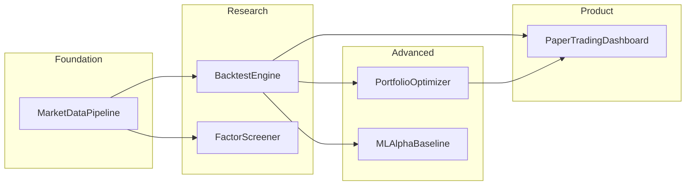

# Quant Finance Portfolio (Python)

A monorepo of six quant-finance projects for software engineering students: data ingestion, backtesting, factor research, portfolio optimization, ML alpha, and paper trading. **Projects 1–3 are implemented**; 4–6 are scaffolded for future work.

## Architecture



## Quick start

```bash
# Install with backtest + dev dependencies
pip install -e ".[backtest,dev]"

# Option A: seed offline sample data (no network; skips symbols that already have data)
python scripts/seed_sample_data.py

# Option B: fetch live data from Yahoo Finance
quant-fetch --config config/watchlist.yaml

# Run backtest (dual moving-average on SPY)
quant-backtest --strategy dual_ma --symbol SPY

# Factor research (IC report + latest screen)
quant-factors --exclude SPY

# Data quality report
quant-quality --config config/watchlist.yaml

# Tests
pytest -v
```

## Project status

| # | Module | Status | Description |
|---|--------|--------|-------------|
| 1 | `data_pipeline/` | **Done** | Idempotent OHLCV ETL → Parquet + SQLite metadata |
| 2 | `backtester/` | **Done** | Event-driven engine, dual-MA & pair mean-reversion |
| 3 | `factors/` | **Done** | Cross-sectional factor screener + rank IC |
| 4 | `portfolio/` | Scaffold | Markowitz optimizer with constraints |
| 5 | `ml_alpha/` | Scaffold | ML baselines with purged time-series CV |
| 6 | `paper_trading/` | Scaffold | FastAPI + Streamlit paper trading |

## Project 1: Market Data Pipeline

**Resume hook:** *Built a reproducible ETL pipeline for OHLCV equity data.*

- CLI: `quant-fetch`
- Normalized schema: `symbol`, `date`, `open`, `high`, `low`, `close`, `volume`
- Storage: Parquet per symbol under `data/parquet/`
- Metadata: SQLite tracks `last_date`, row counts, errors
- Idempotent incremental fetches (skips up-to-date symbols)
- Retries with configurable delay
- Quality report: `quant-quality` (missing %, stale symbols, volume spikes)

### Limitations (document honestly in interviews)

- Yahoo Finance data may have gaps and is not adjusted for all corporate actions consistently
- No survivorship-bias-free index membership history in v1
- Approximate trading-day missing % (weekends/holidays not fully modeled)

## Project 2: Backtest Engine

**Resume hook:** *Implemented an event-driven backtester with transaction costs.*

- Strategies: `DualMovingAverageCrossover`, `MeanReversionPair` (KO/PEP)
- Costs: configurable commission + slippage (default 5 bps each)
- Metrics: total return, Sharpe, max drawdown, win rate, turnover
- Benchmark: buy-and-hold comparison
- No lookahead: signals shifted by one bar before execution

```bash
# Dual MA on SPY
quant-backtest --strategy dual_ma --symbol SPY --fast 20 --slow 50

# Mean reversion on KO/PEP pair
quant-backtest --strategy mean_reversion --pair KO PEP
```

Outputs: `reports/backtest_results.json`, `reports/equity_curve.png`

## Results (live data, dual-MA 20/50 on SPY)

Run on Yahoo Finance daily bars, Jan 2020 – Oct 2026 (`quant-fetch`):

| Metric | Strategy | Buy & Hold |
|--------|----------|------------|
| Total return | 78.36% | 163.11% |
| Sharpe (ann.) | 0.77 | 0.82 |
| Max drawdown | -28.93% | -33.72% |
| Trades | 83 | — |

The crossover cuts the drawdown a little but gives up about half of the buy-and-hold return after costs. That's a typical result for trend filters on a strongly trending index. *Past performance does not guarantee future results.*


## Project 3: Factor Screener

**Resume hook:** *Built a cross-sectional factor research tool measuring rank IC on non-overlapping horizons.*

- CLI: `quant-factors`
- Factors (`factors/library.py`): momentum 12-1, 1-month reversal, low volatility, liquidity (log dollar volume)
- Evaluation (`factors/analysis.py`): Spearman rank IC per rebalance date, IC mean / IR / t-stat / hit rate, quantile forward returns and top-minus-bottom spread
- Rebalance dates are spaced by the horizon (default 21 days) so forward-return windows don't overlap and t-stats aren't inflated
- Screen: equal-weight composite of cross-sectional z-scores, ranked on the latest date
- No lookahead: a test perturbs future prices and checks past factor values are unchanged

```bash
quant-factors --exclude SPY --horizon 21 --quantiles 3
```

Outputs: `reports/factor_report.json`, `reports/factor_ic.png`

### Results (9 large caps, 2020–2026, 21-day horizon)

| Factor | IC mean | t-stat | Hit rate |
|--------|---------|--------|----------|
| momentum_12_1 | 0.045 | 0.93 | 59% |
| reversal_1m | 0.004 | 0.11 | 52% |
| low_vol | -0.055 | -0.98 | 47% |
| liquidity | 0.047 | 0.83 | 47% |

None of the factors is statistically significant (|t| < 2). With only 9 names, each cross-section is very noisy, so treat this as a working pipeline, not as evidence of alpha. Low-vol's negative IC matches the 2020–2026 period, when high-beta tech led the market.


### Limitations

- Tiny, survivor-biased universe (today's mega caps), so you need many more names for meaningful IC
- Price/volume factors only; value and quality need fundamentals data

## Repository layout

```
Quant/
├── config/watchlist.yaml
├── data_pipeline/       # P1: fetch, store, quality
├── backtester/          # P2: engine, strategies, metrics
├── factors/             # P3: factor library, IC analysis, screener
├── portfolio/           # P4 scaffold
├── ml_alpha/            # P5 scaffold
├── paper_trading/       # P6 scaffold
├── shared/              # types, config, db utils
├── scripts/seed_sample_data.py
├── tests/
├── reports/             # backtest outputs
└── pyproject.toml
```

## Development

```bash
make install   # pip install -e ".[backtest,dev]"
make test
make seed
make backtest
make factors
make lint      # ruff
```

## Resume bullets

- Built Parquet-based equity ETL with idempotent daily updates, SQLite metadata, and pytest coverage on parsers and pipeline orchestration.
- Implemented event-driven backtester with dual-MA strategy, 5 bps transaction costs, and buy-and-hold benchmark comparison.
- Built a cross-sectional factor screener (momentum, reversal, low-vol, liquidity) with rank-IC and quantile-spread evaluation on non-overlapping horizons and lookahead-bias tests.

## License

MIT
