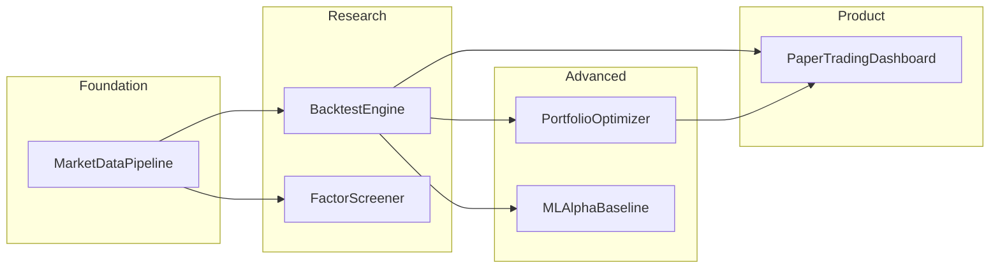
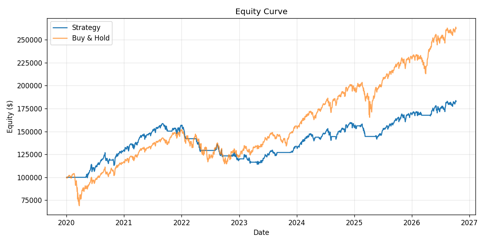
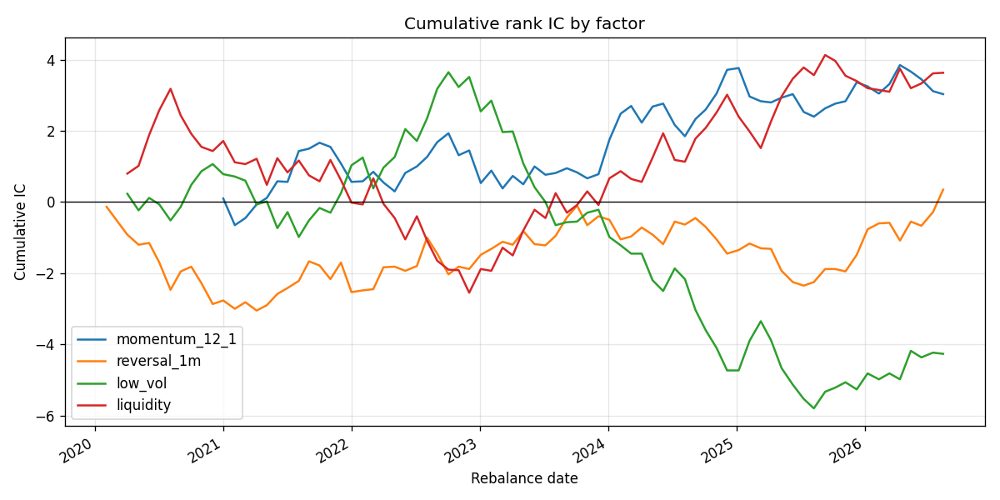
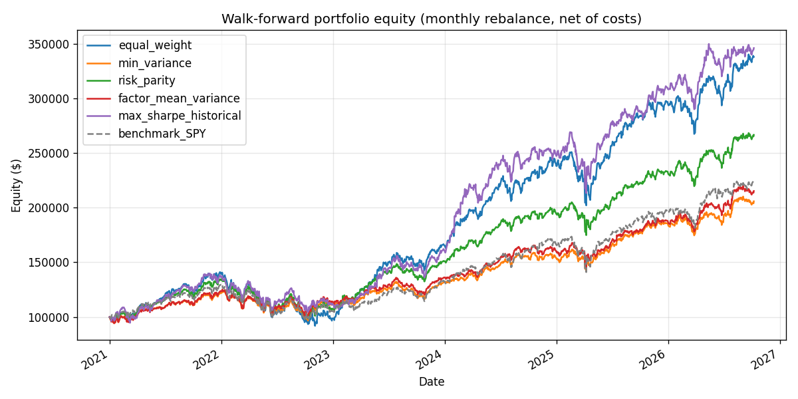
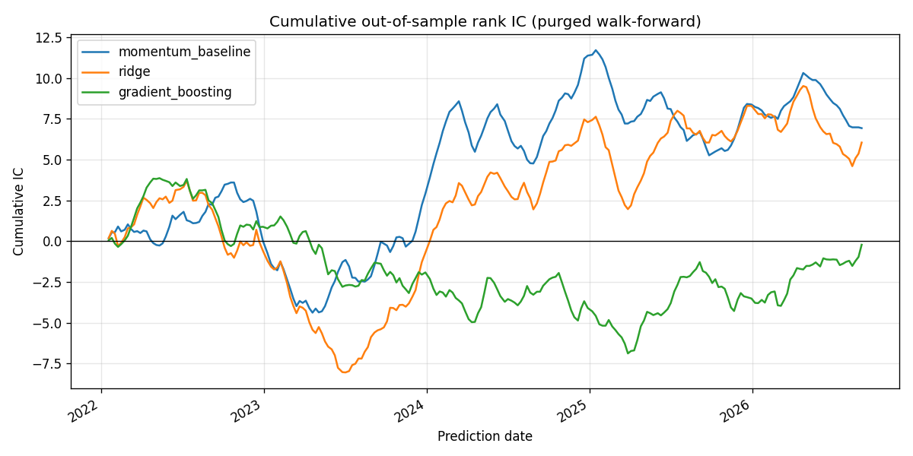

# Quant Finance Portfolio (Python)

A monorepo of six quant-finance projects for software engineering students: data ingestion, backtesting, factor research, portfolio optimization, ML alpha, and paper trading. **All six projects are implemented.**

## Architecture



## Quick start

```bash
# Install everything (research, ML, dashboard, API, tests)
pip install -e ".[all]"

# Option A: seed offline sample data (no network; skips symbols that already have data)
python scripts/seed_sample_data.py

# Option B: fetch live data from Yahoo Finance
quant-fetch --config config/watchlist.yaml

# Run backtest (dual moving-average on SPY)
quant-backtest --strategy dual_ma --symbol SPY

# Factor research (IC report + latest screen)
quant-factors --exclude SPY

# Portfolio optimization (walk-forward comparison + current weights)
quant-optimize --exclude SPY

# ML alpha: purged walk-forward CV vs leaky CV
quant-ml --exclude SPY

# Dashboard (http://localhost:8501) and paper trading API (http://127.0.0.1:8000/docs)
quant-dashboard
quant-paper-api

# Data quality report
quant-quality --config config/watchlist.yaml

# Tests
pytest -v
```

## Project status

| # | Module | Status | Description |
|---|--------|--------|-------------|
| 1 | `data_pipeline/` | **Done** | Idempotent OHLCV ETL → Parquet + SQLite metadata |
| 2 | `backtester/` | **Done** | Event-driven engine, dual-MA & pair mean-reversion |
| 3 | `factors/` | **Done** | Cross-sectional factor screener + rank IC |
| 4 | `portfolio/` | **Done** | Constrained optimizers + walk-forward comparison |
| 5 | `ml_alpha/` | **Done** | ML baselines with purged time-series CV |
| 6 | `paper_trading/` | **Done** | Streamlit dashboard + FastAPI paper broker |

## Project 1: Market Data Pipeline

**Resume hook:** *Built a reproducible ETL pipeline for OHLCV equity data.*

- CLI: `quant-fetch`
- Normalized schema: `symbol`, `date`, `open`, `high`, `low`, `close`, `volume`
- Storage: Parquet per symbol under `data/parquet/`
- Metadata: SQLite tracks `last_date`, row counts, errors
- Idempotent incremental fetches (skips up-to-date symbols)
- Retries with configurable delay
- Quality report: `quant-quality` (missing %, stale symbols, volume spikes)

### Limitations (document honestly in interviews)

- Yahoo Finance data may have gaps and is not adjusted for all corporate actions consistently
- Prices are split/dividend-adjusted, but incremental fetches don't re-adjust older bars when a new dividend is paid, so do a full re-fetch periodically
- No survivorship-bias-free index membership history in v1
- Approximate trading-day missing % (weekends/holidays not fully modeled)

## Project 2: Backtest Engine

**Resume hook:** *Implemented an event-driven backtester with transaction costs.*

- Strategies: `DualMovingAverageCrossover`, `MeanReversionPair` (KO/PEP)
- Costs: slippage moves the fill price and commission is charged once on notional (default 5 bps each)
- Trades only when the signal changes; longs are sized net of costs so cash never goes negative
- Metrics: total return, Sharpe, max drawdown, win rate, turnover
- Benchmark: buy-and-hold comparison
- No lookahead: signals shifted by one bar before execution

```bash
# Dual MA on SPY
quant-backtest --strategy dual_ma --symbol SPY --fast 20 --slow 50

# Mean reversion on KO/PEP pair
quant-backtest --strategy mean_reversion --pair KO PEP
```

Pair trades run on a dollar-neutral spread (long $1 of A, short $1 of B, rebalanced daily), and costs are charged on both legs.

Outputs: `reports/backtest_results.json`, `reports/equity_curve.png`

## Results (live data, dual-MA 20/50 on SPY)

Run on Yahoo Finance daily bars (split- and dividend-adjusted), Jan 2, 2020 – Oct 8, 2026 (`quant-fetch`):

| Metric | Strategy | Buy & Hold |
|--------|----------|------------|
| Total return | 82.47% | 162.00% |
| Sharpe (ann.) | 0.80 | 0.81 |
| Max drawdown | -28.08% | -33.72% |
| Trades | 27 | — |
| Costs paid | $3,668 | — |

The crossover cuts the drawdown a little but gives up about half of the buy-and-hold return after costs. That's a typical result for trend filters on a strongly trending index. *Past performance does not guarantee future results.*

KO/PEP mean reversion over the same period (20-day z-score, enter at ±2, exit at ±0.5) loses money: -22.7% total return, Sharpe -0.31, 125 trades, against +49.3% for simply holding the long-KO/short-PEP spread. The raw price-difference spread isn't stable enough to fade, and the round trips get eaten by double-leg costs.



## Project 3: Factor Screener

**Resume hook:** *Built a cross-sectional factor research tool measuring rank IC on non-overlapping horizons.*

- CLI: `quant-factors`
- Factors (`factors/library.py`): momentum 12-1, 1-month reversal, low volatility, liquidity (log dollar volume)
- Evaluation (`factors/analysis.py`): Spearman rank IC per rebalance date, IC mean / IR / t-stat / hit rate, quantile forward returns and top-minus-bottom spread
- Rebalance dates are spaced by the horizon (default 21 days) so forward-return windows don't overlap and t-stats aren't inflated
- Screen: equal-weight composite of cross-sectional z-scores, ranked on the latest date
- No lookahead: a test perturbs future prices and checks past factor values are unchanged

```bash
quant-factors --exclude SPY --horizon 21 --quantiles 3
```

Outputs: `reports/factor_report.json`, `reports/factor_ic.png`

### Results (9 large caps, Jan 2020 – Oct 8, 2026, 21-day horizon)

| Factor | IC mean | t-stat | Hit rate |
|--------|---------|--------|----------|
| momentum_12_1 | 0.045 | 0.93 | 59% |
| reversal_1m | 0.004 | 0.11 | 52% |
| low_vol | -0.055 | -0.98 | 47% |
| liquidity | 0.047 | 0.83 | 47% |

None of the factors is statistically significant (|t| < 2). With only 9 names, each cross-section is very noisy, so treat this as a working pipeline, not as evidence of alpha. Low-vol's negative IC matches the 2020–2026 period, when high-beta tech led the market.



### Limitations

- Tiny, survivor-biased universe (today's mega caps), so you need many more names for meaningful IC
- Price/volume factors only; value and quality need fundamentals data

## Project 4: Portfolio Optimizer

**Resume hook:** *Built a constrained portfolio optimizer and compared allocators in a walk-forward backtest net of costs.*

- CLI: `quant-optimize`
- Covariance (`portfolio/estimators.py`): Ledoit-Wolf shrinkage toward scaled identity, implemented from the paper and checked against scikit-learn in tests
- Expected returns: trailing mean, or factor alpha `IC × vol × z-score` from the Project 3 composite (Grinold's rule)
- Optimizers (`portfolio/optimizer.py`, SciPy SLSQP): min variance, mean-variance, max Sharpe, risk parity (equal risk contribution), equal weight. Long-only, fully invested, per-asset cap.
- Walk-forward (`portfolio/walkforward.py`): monthly rebalance, 252-day trailing estimation window only, 10 bps cost on turnover, weights drift between rebalances

```bash
quant-optimize --exclude SPY --max-weight 0.25 --cost-bps 10
```

Outputs: `reports/portfolio_report.json` (walk-forward metrics, current weights, risk contributions), `reports/portfolio_equity.png`

### Results (9 large caps, Jan 2021 – Oct 8, 2026, net of costs)

| Allocator | Total return | Sharpe | Max DD | Avg turnover / rebalance | Effective holdings |
|-----------|--------------|--------|--------|--------------------------|--------------------|
| Equal weight | 238.4% | 1.13 | -34.9% | 5% | 9.0 |
| Min variance | 106.1% | 0.95 | -22.0% | 9% | 4.9 |
| Risk parity | 167.0% | 1.13 | -26.9% | 6% | 7.4 |
| Factor mean-variance | 115.5% | 0.99 | -20.4% | 24% | 4.9 |
| Max Sharpe (trailing mean) | 246.5% | 1.19 | -25.2% | 29% | 4.6 |
| SPY buy & hold | 123.5% | 0.92 | -24.5% | — | — |

What this shows:
- Min variance and risk parity deliver what they promise: lower drawdowns than equal weight. They pay for it in return, because they tilt toward KO, PEP and JPM.
- Max Sharpe on trailing means came out on top, but it turns over ~6× more than equal weight and is notoriously unstable out of sample. It won here because big tech kept trending, so don't read it as a robust result.
- The factor tilt didn't add value. That's consistent with the insignificant ICs from Project 3.



### Limitations

- The universe is today's mega-cap winners, so every long-only allocator beating SPY is mostly survivorship bias
- Single 9-asset universe and a single period, so differences between allocators are not statistically tested
- Costs are a flat bps on turnover, with no market impact or borrow

## Project 5: ML Alpha Baseline

**Resume hook:** *Built ML return-prediction baselines with purged walk-forward cross-validation and quantified how much leaky CV inflates results.*

- CLI: `quant-ml`
- Dataset (`ml_alpha/features.py`): one row per (date, symbol), sampled weekly. 11 cross-sectionally ranked features: short/medium-term returns, 21-day volatility, distance to the 50/200-day MA, volume z-score, and the four Project 3 factors.
- Label: 21-day forward return, demeaned across symbols, so models predict which names beat the others rather than market direction
- CV (`ml_alpha/cv.py`): expanding-window walk-forward split by date. Training samples whose 21-day label window reaches into the test block are **purged**, plus a 5-day embargo.
- Models (`ml_alpha/models.py`): momentum-rank baseline (no fitting), ridge regression, gradient-boosted trees (scikit-learn `HistGradientBoostingRegressor`)
- Evaluation: out-of-sample rank IC per date, t-stat on non-overlapping dates only, top-minus-bottom tercile spread. Each model is also scored with a shuffled K-fold to show the leakage effect.

```bash
quant-ml --exclude SPY --horizon 21 --splits 5 --embargo-days 5
```

Outputs: `reports/ml_report.json`, `reports/ml_oos_ic.png`. The same evaluation is interactive in the dashboard's **ML alpha** tab.

### Results (9 large caps, out-of-sample Jan 2022 – Sep 2026)

| Model | OOS IC (purged) | t-stat | Long-short (ann.) | IC with leaky shuffled K-fold |
|-------|-----------------|--------|-------------------|-------------------------------|
| Momentum baseline | 0.031 | 0.55 | -0.8% | 0.031 |
| Ridge | 0.038 | 0.75 | +1.5% | 0.085 |
| Gradient boosting | 0.007 | 0.14 | -2.2% | **0.243** |

What this shows:
- **Leakage is the headline.** Under a shuffled K-fold, gradient boosting looks like a strong signal (IC 0.24). Evaluated properly, it's indistinguishable from zero. The baseline, which learns nothing, scores the same under both schemes, which confirms the gap comes from training on overlapping future labels.
- Ridge only matches the one-feature momentum baseline, and nothing is statistically significant. With 9 stocks there's simply too little cross-sectional signal to learn.



### Limitations

- 9 names × ~285 weekly dates: far too small for ML to beat simple baselines; a broad universe (e.g. S&P 500) is the real test
- Hyperparameters are fixed, not tuned. Tuning would need a nested purged CV to avoid a new layer of leakage.
- Price/volume features only; no fundamentals, sentiment or alternative data

## Project 6: Paper Trading Dashboard

**Resume hook:** *Shipped a Streamlit research dashboard and a FastAPI paper-trading service backed by a SQLite broker.*

```bash
quant-dashboard     # Streamlit UI on http://localhost:8501
quant-paper-api     # REST API, interactive docs on http://127.0.0.1:8000/docs
```

**Dashboard tabs** (`paper_trading/dashboard.py`):
- **Market**: price chart with moving averages for any watchlist symbol
- **Backtest**: dual-MA or pair mean reversion with sliders for windows and costs, metrics vs buy & hold
- **Factors**: rank IC table, cumulative IC chart and latest composite screen, with horizon/quantile controls
- **Portfolio**: walk-forward comparison of all allocators, with max-weight and cost sliders, plus today's weights
- **ML alpha**: purged vs leaky CV comparison, out-of-sample IC table and chart, ridge coefficients, today's model rankings (horizon, splits and embargo sliders)
- **Paper trading**: account equity and P&L, order ticket, one-click rebalance to any allocator, positions, order history, reset

**Paper broker** (`paper_trading/broker.py`):
- Long-only cash account persisted in SQLite (`data/paper_trading.sqlite`, git-ignored), shared by the dashboard and the API
- Whole-share market orders filled at the latest local close ± 5 bps slippage, plus 5 bps commission
- Average-cost positions, realized and unrealized P&L
- Rejected orders (insufficient cash, overselling, unknown symbol) are logged with a reason
- Rebalancing sells first to free cash, sizes buys net of costs, and liquidates holdings outside the target

**API** (`paper_trading/api.py`): `GET /account`, `/positions`, `/orders`, `/prices/{symbol}`, `/allocations/{method}`; `POST /orders`, `/rebalance`, `/reset`. Rejected orders return HTTP 400 with the reason.

### Limitations

- Prices are end-of-day closes from the local store, so fills only "move" after `quant-fetch`. There's no intraday feed or live broker connection.
- Market orders only (no limit/stop orders), single account, no authentication. The API is meant to run on localhost.

## Repository layout

```
Quant/
├── config/watchlist.yaml
├── data_pipeline/       # P1: fetch, store, quality
├── backtester/          # P2: engine, strategies, metrics
├── factors/             # P3: factor library, IC analysis, screener
├── portfolio/           # P4: estimators, optimizers, walk-forward
├── ml_alpha/            # P5: features, purged CV, models
├── paper_trading/       # P6: broker, API, Streamlit dashboard
├── shared/              # types, config, db utils
├── scripts/seed_sample_data.py
├── tests/
├── reports/             # backtest outputs
└── pyproject.toml
```

## Development

```bash
make install   # pip install -e ".[all]"
make test
make seed
make backtest
make factors
make optimize
make ml
make dashboard
make api
make lint      # ruff
```

## Resume bullets

- Built Parquet-based equity ETL with idempotent daily updates, SQLite metadata, and pytest coverage on parsers and pipeline orchestration.
- Implemented event-driven backtester with dual-MA strategy, 5 bps transaction costs, and buy-and-hold benchmark comparison.
- Built ML return-prediction baselines (ridge, gradient boosting) with purged walk-forward CV and showed a shuffled K-fold inflates out-of-sample IC from ~0 to 0.24.
- Shipped a Streamlit dashboard and FastAPI service over a SQLite paper broker that rebalances a live account to any research allocator.
- Built a long-only constrained optimizer (min-variance, risk parity, max-Sharpe, factor mean-variance) with Ledoit-Wolf covariance and compared allocators in a walk-forward backtest net of transaction costs.
- Built a cross-sectional factor screener (momentum, reversal, low-vol, liquidity) with rank-IC and quantile-spread evaluation on non-overlapping horizons and lookahead-bias tests.

## License

MIT
